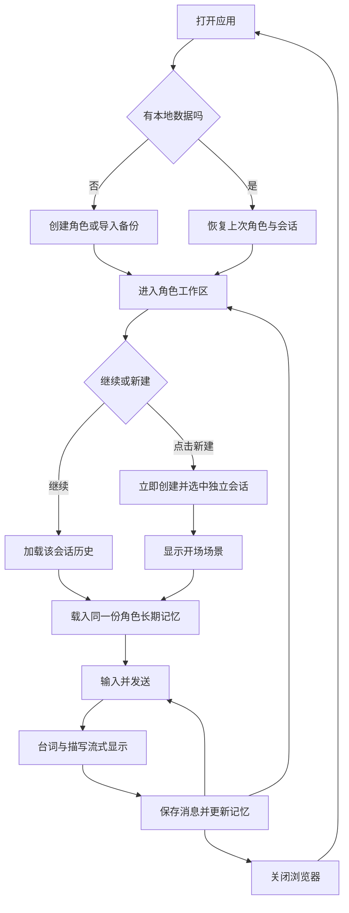
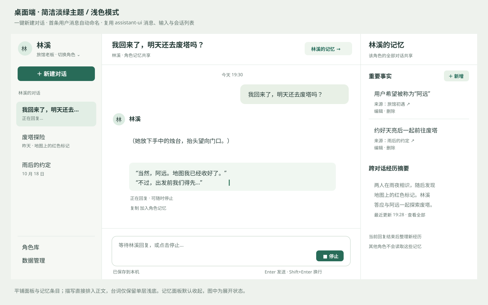
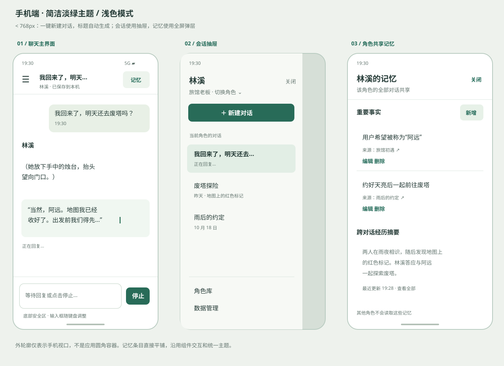
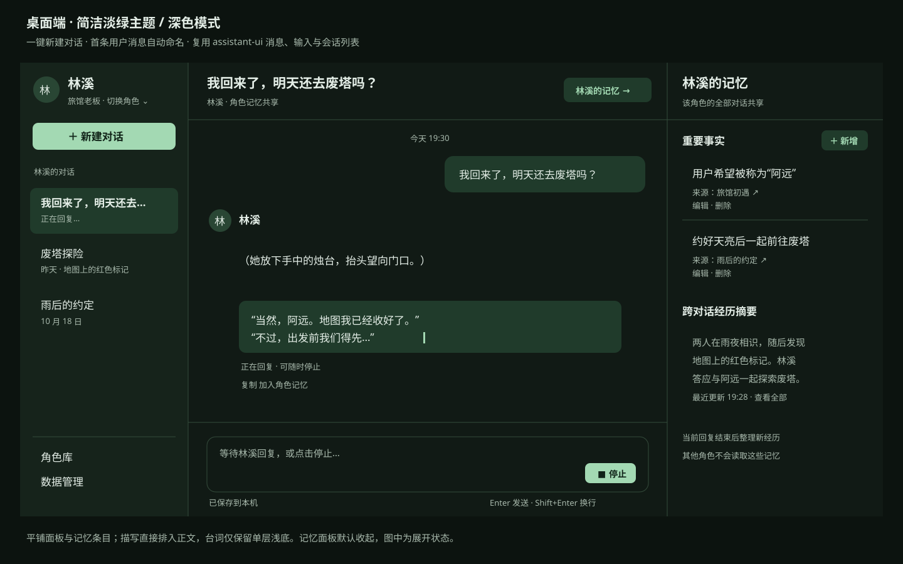
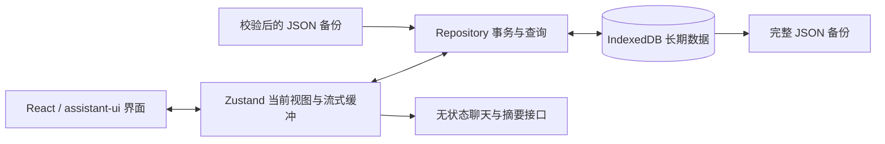

# AI 角色聊天系统：前端设计

日期：2026-10-20。本文定义前端目标体验与数据方案，当前实现范围见下方说明。

> 本次实现范围：只接入现有 `POST /api/chat`，Java 后端不变。已实现角色与多会话管理、一键创建与自动标题、人工共享记忆与手动共享经历、分段流式聊天、淡绿明暗主题、手机适配、IndexedDB 保存与中断恢复、完整备份导入导出。自动摘要及其事件处理队列、图片附件不在本次实现范围。较早记录在预算内以原文进入 `summary`，超过预算后提示手工整理剧情，不静默丢弃历史。重开后恢复选中会话、最近消息和草稿，精确阅读锚点恢复留待后续。运行与验证方法见 [frontend/README.md](../frontend/README.md)。

本文承接[前后端开发计划](./AI%20角色聊天系统-前后端开发计划.md)，并按本次需求调整两项决策：**长期记忆归属于角色，同一角色的多个会话共享；流式回复定期保存检查点，重新打开时保留已保存的部分内容。** 旧计划中“记忆属于会话”“不做跨会话记忆”“生成中刷新会丢失全部回复”的规定，以本文为准。其他角色的记忆互相隔离。

补充设计约束：**界面简洁，优先复用 assistant-ui 成品组件与交互；统一淡绿色主题，支持浅色、深色和跟随系统；避免圆角容器嵌套；新建会话一键完成，首次发送时自动命名。** 下文按这些约束定义界面与实现方式。

## 1. 用户要获得的体验

用户先选择或创建一个角色，再与这个角色开始一段对话。以后既可以继续原来的对话，也可以创建新的对话；新的对话有独立聊天记录，但角色仍记得与用户长期相处中积累的信息。

例如：用户在林溪的“旅馆初遇”中说“请叫我阿远”，将这句话加入角色记忆后，打开林溪的“废塔探险”，林溪仍能使用这个称呼；新会话不直接展示“旅馆初遇”的聊天记录。换成另一个角色，则不会继承林溪的记忆。

本设计中的“新对话”默认发生在同一角色的连续关系中，并不表示平行世界或清空记忆。需要完全独立的人设与经历时，使用“复制为新角色”，仅复制角色设定，不复制记忆和聊天记录。

### 1.1 核心规则

| 对象 | 职责 | 生命周期 |
| --- | --- | --- |
| 角色 | 身份、性格、世界观、说话方式 | 长期保存，能被多个会话引用 |
| 角色长期记忆 | 用户确认的重要事实、跨会话经历摘要 | 以 `characterId` 关联，所有该角色会话共用 |
| 会话 | 一段故事的标题、角色设定快照、局部剧情摘要 | 独立保存、切换和删除 |
| 消息 | 用户输入、角色台词和描写 | 属于一个会话，按稳定序号排列 |
| 输入草稿 | 尚未发送的文字、阅读位置 | 每个会话各自保存 |

“共享记忆”指共享同一份角色记忆数据，并在每次请求时注入；不等于把所有会话原文无限发送给模型，也不能保证模型逐字记住全部历史。原文始终留在本地，重要事实可由用户明确维护。

### 1.2 本次设计范围

- 角色选择、创建、编辑、复制和归档。
- 同一角色下创建、继续、重命名和删除多个会话。
- 文字聊天、台词与描写分段渲染、流式新增、停止生成、复制内容。
- 角色长期记忆的查看、新增、编辑、删除，以及从消息中摘录记忆。
- 会话历史压缩、跨会话经历摘要、记忆更新状态提示。
- 手机、平板与桌面布局；本地恢复、备份、导入和存储状态。
- 淡绿色主题，支持浅色、深色与跟随系统，记住用户选择。

图片附件作为后续扩展：当前后端拒绝图片输入，第一阶段不显示附件发送入口。本文中的布局图用于解释界面，不依赖图片输入功能。暂不提供登录、云同步、多个角色群聊、消息分支、编辑已发送消息、自动重连或重新生成等功能。

## 2. 页面与功能清单

使用一个应用入口 `/`，通过选中角色、选中会话和弹层组织操作，延续现有 Next.js 项目结构。第一版不增加复杂路由；刷新后根据本地记录恢复当前位置。

| 界面 | 必须展示 | 主要操作与状态 |
| --- | --- | --- |
| 首次使用 / 角色库 | 简洁角色列表、名称、简介、最近互动时间 | 选择角色、新建角色、导入备份；空列表有明确引导 |
| 角色编辑 | 名称、身份背景、性格、说话风格、世界观、开场场景 | 保存、取消；名称与身份背景必填，其余选填；未保存离开时保留表单草稿 |
| 角色工作区 | 当前角色、该角色的会话列表、共享记忆入口 | 新建会话、搜索会话标题、切换角色、编辑设定、复制、归档 |
| 新建会话（按钮操作） | 当前角色与默认开场场景 | 点击即创建并切换，无创建弹窗、无命名步骤；首条用户消息自动命名，之后可手动改名 |
| 聊天主界面 | 会话标题、角色、消息、生成状态、输入框 | 发送、停止、复制、摘录为记忆、向上加载历史、回到最新 |
| 角色记忆面板 | 人工重要记忆、自动经历摘要、更新时间与状态 | 新增、编辑、删除重要记忆；查看来源会话；展开经历摘要 |
| 会话详情 / 菜单 | 标题、创建时间、采用的人设版本 | 重命名、查看局部摘要、删除会话 |
| 数据管理 / 设置 | 主题偏好、本地存储状态、数据数量、最近导出时间 | 浅色/深色/跟随系统；导出全部、预检导入、覆盖恢复、查看持久存储状态、清空数据 |
| 启动恢复 | 加载提示、恢复进度、异常信息 | 正常自动进入；存储打开失败提供重试，不显示“空数据”误导用户 |

第一版角色可归档、取消归档，不单独实现角色永久删除。归档后数据和会话仍保留，在角色库“已归档”中可恢复；数据管理中的“清空全部数据”才执行全量删除。

角色编辑保存后，新建会话采用新设定，已有会话继续使用创建时的快照。记忆仍按同一 `characterId` 共享；表单提示这两种作用范围。会话标题只用于导航，不进入角色人设。

## 3. 从用户角度组织流程



### 3.1 第一次使用

1. 用户看到“创建你的第一个角色”，也可以直接导入已有备份。
2. 填写角色资料。保存成功即进入该角色工作区，突出显示“开始对话”。
3. 点击“开始对话”即使用当前角色和默认开场场景创建会话，不要求输入或确认标题。
4. 角色、会话和开场消息分别按下文事务规则保存；成功后聚焦输入框。
5. 非空开场场景作为一条 `narration` 消息显示，不发起模型请求；空开场显示“向角色打个招呼”。重新进入不会重复插入开场。

### 3.2 日常聊天与多个会话

1. 再次打开时恢复上次角色、会话、最近消息、输入草稿及阅读位置。
2. 用户发送内容后立即看到自己的消息，输入按钮变成“停止”，角色回复逐步出现。
3. 用户点击“新建对话”即可在同一角色下新开另一会话，直接进入输入状态。其消息列表从开场开始，角色记忆面板与旧会话一致。
4. 可以随时切换去阅读其他会话；生成任务始终绑定发起时的 `sessionId`，继续在原会话保存。列表标记哪段对话仍在生成。
5. 第一版全应用同时只允许一个生成任务。在其他会话阅读时，输入区提示“另一段对话正在回复”，提供跳转及停止操作，避免回复串入当前会话。

桌面键盘默认 Enter 发送、Shift+Enter 换行；中文输入法组合输入期间不得发送。手机端 Enter 默认换行，使用显式发送按钮。

### 3.3 维护长期记忆

1. 用户打开“林溪的记忆”，看到“重要事实”和“经历摘要”，标题下始终写明“该角色的全部对话共享”。
2. 可以直接新增事实，也可以选中一条消息的“加入记忆”，确认摘录内容后保存。记忆保留来源消息链接。
3. 保存后所有该角色会话立刻读取新版本；已发出的请求不受影响，下一次发送使用更新内容。
4. 自动经历摘要在完整回复保存后异步更新，界面显示“整理中 / 已更新 / 更新失败”，失败不伪装成已完成。
5. 删除会话的确认框明确说明：“删除这段聊天记录，已形成的角色记忆仍会保留”。删除操作不级联删除角色记忆。

删除一条重要事实，只移除这条独立记忆。若同一信息仍存在于原文或自动摘要中，模型仍可能提及它；记忆面板在删除确认中说明这一点。第一版不提供“彻底遗忘某事实”的承诺。

### 3.4 关闭与恢复

用户无需点击“保存”才能关闭浏览器。角色、会话、记忆和已发送消息在操作发生时保存；输入草稿和流式回复按短周期检查点保存。重新打开后恢复已提交的数据，正在生成的回复显示为“上次生成中断”，保留已保存的正文并允许继续发送新消息，不自动重发请求。

### 3.5 一键创建与会话标题

- 当前角色下始终提供“新建对话”按钮。点击后立即创建并选中会话、显示默认开场，桌面聚焦输入框；手机避免强制弹出软键盘，用户可直接点输入框开始。创建期间按钮短暂禁用，避免重复点击产生意外副本。
- 尚未发送用户消息时标题为“新对话”，`titleSource = "default"`。开场描写不参与命名，也不为命名调用模型。
- 首条用户消息成功写入本地时，将文字首尾空白去除、连续空白与换行合并为一个空格，取前 20 个可见字符；超出时在末尾加 `…`。按 Unicode 字素簇截取，避免截坏 emoji 等组合字符。
- 自动标题与首条用户消息在同一个发送事务中保存，`titleSource` 改为 `"first-message"`；网络失败或生成中断不影响命名。例：“我回来了，明天还去废塔吗？”直接作为会话标题。
- 会话菜单提供“重命名”，使用已有表单输入与弹层，保存后设为 `"manual"`。手动改名后不再自动覆盖，包括用户在发送首条消息前已经命名的情况；判断依据是 `titleSource`，不能仅判断标题是否等于“新对话”。
- 重命名不能为空，默认限制 60 个可见字符；列表过长时单行省略，完整标题可在会话详情查看。用户不改名也能完成全部聊天流程。

## 4. 布局与响应式交互

### 4.1 桌面布局



图为浅色模式结构示意，主题与容器层级遵循下文约束。桌面以聊天阅读为主体：左栏约 264px；中间聊天列 `minmax(0, 1fr)`，正文最大宽度约 760px；右侧记忆面板约 320px，仅在打开时占位，默认收起。顶部位于聊天列，输入区保持可见，优先保留 assistant-ui 原有消息滚动与输入区结构。

角色切换入口放在左上方；下面只列出当前角色的会话，避免把不同角色的故事混在一起。左栏底部固定放“角色库”和“数据管理”。记忆入口位于角色名旁，避免被理解为某条会话专属设置。

### 4.2 手机布局



| 视口宽度 | 布局 | 导航和记忆面板 |
| --- | --- | --- |
| 小于 768px | 单列聊天，内容占满可用宽度 | 左上按钮打开会话抽屉；记忆为全屏弹层；角色库为全屏列表 |
| 768–1199px | 固定左栏 + 聊天 | 记忆以覆盖式侧栏展示，避免正文被挤窄 |
| 大于等于 1200px | 左栏 + 聊天 + 可选记忆栏 | 三栏并排，聊天仍保留足够阅读宽度 |

- 最小验收宽度为 320px，不出现页面级横向滚动。聊天内容使用 `overflow-wrap: anywhere`，长网址不会撑破布局。
- 外层使用动态视口高度 `100dvh`，Flex/Grid 子项设置 `min-height: 0`；聊天列只保留 assistant-ui 原有的滚动视口，不额外套第二层滚动区。输入区加入 `env(safe-area-inset-bottom)`。
- 输入框从 1 行增长到最多约 5 行，超过后内部滚动；手机输入字号至少 16px，按钮触控区域至少 44×44px。
- 软键盘打开后保证输入框和发送按钮可见；必要时用 `visualViewport` 辅助调整可用高度，在真机验收，不能只看桌面模拟尺寸。
- 抽屉、弹层使用已有 Radix Dialog 组件管理焦点、遮罩及关闭；打开时禁止背景滚动，关闭后焦点回到触发按钮。桌面 Esc 可关闭。
- 角色编辑长表单在手机上全屏，保存栏固定在表单底部；数据管理操作按单列排列。
- 台词使用轻浅底色，描写为无背景正文并保留括号；不增加“描写”标签或额外描写卡片。状态不只依靠动画，支持 `prefers-reduced-motion`。

### 4.3 简洁布局与容器层级

- 页面直接铺满可用视口，左栏、聊天区和记忆区用留白与细分隔线区分，不给整个应用再加一层圆角外框。
- 不采用“圆角面板 → 圆角卡片 → 圆角内容框”的嵌套。记忆面板直接展示条目和分隔线，不把每条记忆放进卡片；角色库、会话列表同样采用平铺列表。
- 消息外层保留 assistant-ui 的布局，不添加整条角色回复的气泡容器。台词仅有一层轻浅背景，描写直接排入正文；两者不再被另一层圆角背景包裹。
- 输入区保留现有 Composer 的单层容器，内部输入控件不重复画圆角边框。按钮保留组件默认形态，不为了取消圆角嵌套而重写其交互。
- 弹层本身可保留组件默认圆角，内部以标题、分区、列表和原有表单控件组织内容，不再套装饰性 Card。头像、按钮等小控件的正常圆角不属于装饰容器嵌套。
- 顶栏只保留会话标题、角色信息、记忆入口和更多菜单。创建时间、人设版本、存储详情放到详情或设置；保存状态仅以轻量状态文字呈现，不增加独立状态卡片。
- 首屏只突出当前角色、新建对话和聊天输入；复杂管理操作收进既有菜单与弹层。复用同一套按钮、间距、图标及焦点样式。

### 4.4 淡绿色主题与明暗模式

主题使用低饱和绿色表达选中、聚焦和主要操作，大面积保持接近白色或暗色中性背景。统一修改 `app/globals.css` 的语义变量，让 assistant-ui 与现有 shadcn/Radix 组件一起继承主题；组件内不散落硬编码颜色，也不增加另一套独立主题系统。

| 语义变量 | 浅色示例 | 深色示例 | 用途 |
| --- | --- | --- | --- |
| `background` | `#FAFCFA` | `#111A15` | 页面与聊天阅读背景 |
| `foreground` | `#20382B` | `#E4EEE7` | 主体正文 |
| `sidebar` | `#F1F7F2` | `#16231B` | 导航底色 |
| `primary` | `#276749` | `#A3D9B3` | 主要按钮、焦点与强调 |
| `primary-foreground` | `#FFFFFF` | `#102318` | 主要按钮文字 |
| `accent` | `#E3F2E6` | `#203B2B` | 会话选中态、台词轻浅底色 |
| `muted-foreground` | `#52695B` | `#A8B9AC` | 次要信息与占位文案 |
| `border` | `#D4E3D7` | `#344B3B` | 面板分隔与输入边界 |

`card`、`popover`、`secondary`、`muted`、`input`、`ring` 及对应前景色沿用同一语义体系配套设置；不因为定义了 `card` 就额外增加卡片。深色模式使用深背景与柔和浅绿强调，避免把浅色模式的大面积浅绿直接照搬。

设置提供“跟随系统 / 浅色 / 深色”，默认跟随系统；偏好存入 IndexedDB `settings.themeMode`，重新打开后恢复。启动时先以系统配色显示加载底色，读取偏好后统一应用根节点 `.dark` 类和 `color-scheme` 再展示应用主体；手动选择后不再响应系统切换。

浅色与深色模式分别检查正文、按钮、占位文案、禁用态、悬停态、选中态与键盘焦点；普通正文对比度至少 4.5:1，不能只反转背景。下图展示相同布局的深色配色：



## 5. 聊天内容与流式输出

### 5.1 台词、描写与用户输入

| 内容 | 视觉表现 | 行为 |
| --- | --- | --- |
| 用户输入 | 右对齐浅色气泡、正文常规字重 | 保留换行，可复制 |
| 角色台词 `dialogue` | 左对齐、常规正文 16px、使用浅底 | 保留模型给出的引号，适合连续阅读 |
| 角色描写 `narration` | 左对齐、无背景、16px，不标注“描写”，算作正文 | 保留括号；中文不强制斜体，保证可读性 |
| 正在生成 | 当前段末尾显示轻量光标，输入区显示“正在回复” | 只更新末尾消息；停止后保留已有内容 |
| 中断或异常 | 回复末尾显示“已停止 / 连接中断 / 上次生成中断” | 部分正文仍可复制，不显示成完整回复 |

同一条角色消息可以依次包含“描写 → 台词 → 描写”。消息外层只展示一次角色名与时间，内部按 `segments` 顺序渲染。第一版采用纯文本，保留换行，不渲染模型返回的 HTML，不通过引号或括号猜测类型。

### 5.2 对接当前流式接口

使用 `POST /api/chat`，请求体沿用现有 DTO。响应事件如下：

```text
event: delta
data: {"kind":"narration","text":"（她抬头看向"}

event: delta
data: {"kind":"narration","text":"窗外。）"}

event: delta
data: {"kind":"dialogue","text":"“你回来了。”"}

event: done
data: {"finishReason":"stop"}
```

通过 `fetch` 读取响应流，不能用仅支持 GET 的原生 `EventSource` 发送此请求。前端只消费后端已经切好的 `kind`，不重复解析 `[台词]` 和 `[描写]`。

处理规则：

1. 流读取使用增量 `TextDecoder`，保留跨网络块的 UTF-8 字符与 SSE 行缓冲；处理 LF、CRLF、注释和多行 `data:`，不能假设一块网络数据就是一个完整事件。
2. `delta` 只追加新增内容。末段 `kind` 相同则追加字符串，否则创建新段；当前协议没有段 ID，因此不尝试还原同类型的独立语义段，保留正文中的换行即可。
3. React 更新按动画帧或约 30–50ms 合批；首段尽快展示，不等待整句，不额外模拟逐字打字动画。原始事件立即进入内存缓冲，合批只控制绘制。
4. 收到 `done` 后提交最后检查点。仅 `finishReason=stop` 显示为正常完整回复；`length` 等原因保留为“输出达到限制”，未知原因保留原值并标记未正常完成。
5. 收到 SSE `error`、非成功 HTTP 状态、非法事件或连接结束前没有 `done`，都进入失败状态。无正文显示错误提示；已有正文保存为部分回复。
6. 停止使用绑定该请求的 `AbortController`，保存已收到内容并标记 `cancelled`。终止处理只执行一次，避免 `done` 与取消竞争时重复入库。
7. `sessionId`、`characterId`、`messageId`、请求标识在发送时捕获。异步回调不得使用“当前选中的会话”作为写入目标。

本地完成状态与模型原因分开保存：`status = complete | cancelled | error | interrupted`；`finishReason` 保存后端原值。空正文但 `done` 的回复展示“本次未返回正文”，不作为有效经历进入自动记忆。

### 5.3 滚动与发送体验

- 自动跟随、上滑后停止跟随、回到底部按钮复用 `Thread` 及 `ThreadPrimitive.ScrollToBottom`；不手写滚动监听与自动跟随引擎。需要微调时调整组件配置或样式，保持其原有行为。
- 向上加载旧消息对接 runtime 的分页能力与现有 `ThreadPrimitive.LoadEarlier`，默认每批 50 条，保留组件视口的阅读位置补偿，不另做分页容器。
- 复制整条回复时按段顺序换行，保留台词与描写正文，不复制传输标记或生成状态。
- 发送按钮防重复点击。输入内容先保存到数据库，成功后清空草稿并发起网络请求；保存失败则保留输入，不能显示发送成功。
- 首条消息不依赖预置英文建议。移除现有示例中的假回复、编辑、重生成、分支、反馈和语音入口。

## 6. 角色记忆如何跨会话共享

### 6.1 三类信息分别保存

| 信息 | 保存位置 | 发给模型的方式 |
| --- | --- | --- |
| 用户确认的重要事实 | `memories.characterId` | 全部有效事实映射到 `memories: string[]` |
| 角色跨会话经历摘要 | `characters.sharedSummary` | 放入 `summary` 中带标题的“角色共享经历”部分 |
| 当前故事的局部剧情 | `sessions.summary` + 当前会话最近消息 | 分别放入 `summary` 的“当前会话剧情”和 `history` |

所有会话读取同一组重要事实和同一份 `sharedSummary`，不复制到会话中。局部摘要属于会话，只为接续当前剧情；不能把它当作角色唯一的长期记忆。不同会话的原始聊天记录也不会混进当前消息列表。

重要事实默认上限 50 条，与当前后端 `MAX_MEMORIES=50` 一致；单条建议限制 300 字符。达到上限时要求用户合并或删除，不能静默丢弃。自动摘要不是第 51 条记忆，走独立的 `summary` 字段。

### 6.2 自动更新与可恢复的进度

为了不在每个流式片段上整理记忆，也不重复扫描所有聊天记录，采用一个很小的本地待处理事件表：

1. 一轮有效回复完成后，在保存终态的同一个事务中，创建 `memoryEvents`，只引用本轮的用户消息、角色消息及所属会话，不复制正文。
2. 每个角色持有单调递增的 `nextMemorySeq` 和 `summaryThroughEventSeq`。处理器按序读取尚未覆盖的事件，读取引用消息后调用计划中的 `/api/summary`，合并到 `sharedSummary`。
3. 一次最多合并约 5 轮，且输入正文合计不超过约 12000 字符。单个超长轮次先按消息和段落分块，在内存中逐块形成临时摘要；全部成功后才提交该事件的最终结果，不能截断后仍把整个事件标为已覆盖。摘要目标约 2000 字符，保留关系、称呼、约定与关键已发生事实；人工事实不由模型覆盖。
4. 网络调用在 IndexedDB 事务之外进行。成功后用事务一起提交新摘要与覆盖序号，并检查角色记忆版本没有变化。失败不推进游标，事件留在本地，下次交互或重开应用时可继续处理，不做无限后台重试。
5. 每个角色同一时间只有一个摘要写入任务；应用导入或清空数据时先终止任务。手工事实的修改也递增角色记忆版本，旧请求不能覆盖新状态。

角色共享摘要在回复完成后启动整理。当前会话继续发送时，未整理的最近内容仍在自己的 `history` 中；切换到另一个会话发送前，先尝试整理该角色未完成的记忆事件，避免新会话立刻读到过期经历。

如果整理失败，允许把尚未整理的完整轮次按来源会话标题组合成“尚未整理的近期经历”，追加到请求 `summary` 中，总量上限约 8000 字符，不占用人工事实的 50 个名额。超出预算时显示“记忆整理失败，需重试后再发送”并提供重试，不能直接丢掉未覆盖的跨会话信息。空摘要、格式不合法或超过目标长度的响应均不推进游标。

只对正常完成、正文非空的轮次自动形成经历事件；取消、失败和刷新中断的片段不自动当成已确认事实，用户仍可手动摘录记忆。自动摘要可能遗失细节，用户可查看来源原文并把关键内容补成重要事实。

### 6.3 当前会话摘要与上下文边界

当前会话未被局部摘要覆盖的完整消息达到 30 条时，将较早的部分整理成 `session.summary`，保留最近约 20 条为原文；截取点落在完整轮次之间。摘要和覆盖序号原子更新，原始消息不删除。

每次发送的 `history` 不包含本轮输入，最多 20 条，与当前 `PromptBuilder` 的截断行为一致。若摘要尚未覆盖的消息超过 20 条，必须先补摘要，再发送；失败则明确提示并允许重试，不能直接 `slice(-20)` 丢掉中间剧情。长历史还需遵守配置的正文预算，按完整轮次压缩，不能仅按条数认为一定能装入模型上下文。

请求组成如下，复用现有后端字段：

```ts
{
  character: session.characterSnapshot,
  memories: characterMemories.map(memory => memory.content),
  summary: joinSections(
    ["角色共享经历", character.sharedSummary],
    ["当前会话剧情", session.summary],
    ["尚未整理的近期经历", pendingExperienceText],
  ),
  history: currentSessionRecentMessages.map(toHistory),
  input: { text: inputText, image: null },
}
```

角色资料采用会话快照，长期记忆采用发送时的角色最新版本。历史中的角色消息由 `segments` 按顺序转为带换行的文本，避免将描写或台词遗漏。

未完成的回复占位不进入请求；已停止或中断且有正文的片段，可在历史中以“以下回复未完成”的文字说明保留。局部摘要覆盖这些终态消息时也须保留未完成性质，不能把其中尚未发生的描述变成确定事实。条数和正文预算在过滤与转换之后计算。

### 6.4 删除与记忆的关系

删除会话之前，先处理其尚未整理的有效经历事件。若无法完成，用户可取消，或明确选择“丢弃尚未整理的经历并删除”。删除消息时同步删除相应事件，已写入的共享摘要和人工事实保留；来源链接显示“原会话已删除”。

清空某个角色的共享经历摘要时，同时将覆盖游标推进到该角色 `nextMemorySeq - 1`，并删除这些旧事件，防止下次启动又从旧聊天自动重建；人工事实由独立操作决定是否清空。此操作仍不会删除现有会话原文和局部摘要。界面不把“清空共享记忆”描述成彻底遗忘。

## 7. 浏览器数据存储方案

### 7.1 分层与唯一数据源



IndexedDB 是唯一长期数据源。Zustand 只放当前角色、会话列表分页、当前消息窗口和生成状态，不通过 Zustand `persist` 再存一份完整历史。React state 不承担持久化。

选择 IndexedDB，是为了异步读写、索引查询、跨表事务和二进制附件；不把整个聊天 JSON 反复序列化进 `localStorage`。设置也存入 IndexedDB，避免数据库与浏览器偏好出现两个版本。IndexedDB 适合较大结构化数据和索引查询，但存储配额由浏览器管理。[存储能力与配额说明](https://developer.mozilla.org/en-US/docs/Web/API/Storage_API/Storage_quotas_and_eviction_criteria)

使用 `idb` 作为轻量 Promise 封装，统一在 `lib/db.ts` 打开数据库。当前实现已创建 `roleplay-agent` v1，包括 `characters / sessions / messages / memories / drafts / settings` 六张表；角色关联索引名为 `character`，消息索引名为 `sequence` 与 `status`。下文的完整目标表结构中，`memoryEvents` 与 `assets` 尚未启用。后续按实际已发布版本增量迁移，不直接重用 v1 覆盖数据库。

### 7.2 Object stores 与索引

| Store | 主键 | 索引 | 用途 |
| --- | --- | --- | --- |
| `characters` | `id` | `updatedAt` | 角色资料、归档状态、共享摘要、记忆版本及事件游标 |
| `sessions` | `id` | `[characterId, updatedAt, id]` | 角色内会话列表、快照、局部摘要、消息序号 |
| `messages` | `id` | 唯一 `[sessionId, seq]`；`status` | 按会话分页；恢复未完成回复 |
| `memories` | `id` | `[characterId, createdAt, id]` | 同一角色的全部人工重要事实 |
| `memoryEvents` | `id` | 唯一 `[characterId, seq]`；`sessionId` | 完整轮次引用及共享摘要待处理进度 |
| `drafts` | `sessionId` | 无 | 会话输入草稿、阅读锚点 |
| `settings` | `key` | 无 | 上次选中的角色/会话、主题、备份时间 |
| `assets`（附件阶段） | `id` | `sessionId` | 头像或消息图片的 Blob 与元数据 |

索引中的复合字段是 IndexedDB 数组 key path；查询会话和消息使用范围游标，不先 `getAll()` 全库再筛选。聊天排序使用会话内递增的 `seq`，时间仅用于展示，不依赖同一毫秒的时间戳排序。

### 7.3 核心数据结构

以下为领域模型草案，具体实现中补齐表单校验和 DTO 映射。时间采用 ISO 字符串，ID 用 `crypto.randomUUID()`；序号由事务内的计数器分配。

```ts
type CharacterProfile = {
  name: string;
  description: string;
  personality: string;
  speakingStyle: string;
  worldSetting: string;
  openingScene: string;
};

type Character = CharacterProfile & {
  id: string;
  archived: boolean;
  profileVersion: number;
  sharedSummary: string;
  memoryRevision: number;
  nextMemorySeq: number;
  summaryThroughEventSeq: number;
  createdAt: string;
  updatedAt: string;
};

type Session = {
  id: string;
  characterId: string;
  title: string;
  titleSource: "default" | "first-message" | "manual";
  characterSnapshot: CharacterProfile;
  profileVersion: number;
  summary: string;
  summaryRevision: number;
  summaryThroughSeq: number;
  nextMessageSeq: number;
  createdAt: string;
  updatedAt: string;
};

type Segment = { kind: "dialogue" | "narration"; text: string };
type Message = {
  id: string;
  sessionId: string;
  seq: number;
  role: "user" | "assistant";
  text?: string;                  // 用户消息正文
  segments?: Segment[];           // 角色消息正文，唯一权威内容
  replyToMessageId?: string;      // 角色回复对应的用户消息
  status: "pending" | "streaming" | "complete"
    | "cancelled" | "error" | "interrupted";
  finishReason?: string;
  requestId?: string;
  checkpointVersion: number;
  createdAt: string;
  updatedAt: string;
};

type Memory = {
  id: string;
  characterId: string;            // 共享边界，不能用 sessionId 替代
  content: string;
  sourceSessionId?: string;      // 可选来源，不是归属
  sourceMessageId?: string;
  createdAt: string;
  updatedAt: string;
};

type MemoryEvent = {
  id: string;                    // 用角色回复 ID，防止重复入队
  characterId: string;
  sessionId: string;
  seq: number;                   // 角色内、完成轮次的递增顺序
  userMessageId: string;
  assistantMessageId: string;
  createdAt: string;
};

type Draft = {
  sessionId: string;
  text: string;
  scrollAnchor?: { messageId: string; offset: number };
  updatedAt: string;
};
```

用户消息不存 `segments`，角色消息不再同时存一份重复全文。请求、复制和备份通过 `toPlainText(message)` 派生文本；台词与描写结构原样保存，恢复时不重新推断类型。

`titleSource` 随会话一同持久化和备份。若后续需要兼容缺失该字段的旧数据，保留已有标题并按 `manual` 迁移，避免自动命名覆盖用户原先的标题。

附件阶段本地用 Blob 存原始二进制，展示时创建 object URL，用完后释放；只在本轮发请求或导出 JSON 时转换成 data URL。单张图片默认限制 2MiB，每条消息最多一张；每个资产只归属一条消息或一份草稿，暂不做跨消息复用和引用计数。

### 7.4 哪些操作需要同一个事务

| 操作 | 原子提交内容 |
| --- | --- |
| 创建会话 | `sessions`、可选开场 `messages`、对应 `drafts` 和选中设置 |
| 发送消息 | 分配两个消息序号、写入完整用户消息和 `pending` 回复占位、按需设置首条消息标题与 `titleSource`、清空输入草稿、更新会话时间 |
| 回复正常结束 | 最终 `segments`、终态、会话时间、角色事件序号和唯一 `memoryEvents` |
| 回复失败 / 停止 | 最终已收到正文、终态和会话时间，不创建自动记忆事件 |
| 修改重要事实 | `memories` 的增删改、角色 `memoryRevision` |
| 摘要更新 | 摘要正文、覆盖游标、摘要/记忆版本；角色摘要同时删除已覆盖事件 |
| 删除会话 | 当前会话的消息、草稿、剩余事件、专属附件和选中设置；保留角色、共享摘要和人工事实 |
| 覆盖导入 | 通过预检的全部业务表和设置一起替换 |

等待事务完成后才能提示“已保存”，不能只等一次 `put()` 成功。事务中不执行 fetch、文件读取或图片解码；这些工作先完成再打开事务，以免事务提前结束。IndexedDB 的事务用于保证相关改动整体提交或回滚。[事务语义参考](https://developer.mozilla.org/en-US/docs/Web/API/IDBTransaction)

### 7.5 流式检查点与草稿

- 流式正文保存在内存，首个非空片段尽快建立检查点；之后每约 500ms、存在新增正文时更新当前回复记录，避免逐 token 写盘。
- 每个回复的写入串行排队，使用递增 `checkpointVersion`。结束或取消时先停止定时器，等待旧检查点完成，再提交终态，防止迟到的 `streaming` 快照覆盖 `complete`。
- 输入草稿在变更后约 300ms 防抖保存；会话切换、输入框失焦时主动提交。新建/编辑角色表单草稿按独立设置项保存，成功提交后清除。
- 输入法 `compositionstart` 到 `compositionend` 期间暂停草稿保存及待执行的防抖定时器，确认文字后再保存，不将候选拼音写成最终草稿。保存状态仅由独立提示组件订阅，页面和聊天 runtime 不订阅它；保存完成不向正在编辑的输入框回写内容，继续复用 assistant-ui 自带的输入法处理。
- 页面进入后台时尽力提交待保存内容，但恢复保证建立在平时的检查点上，不能只依赖关闭页面时异步写盘。`pagehide` 等事件在手机上可能根本不触发。[页面关闭事件的限制](https://developer.mozilla.org/en-US/docs/Web/API/Window/pagehide_event)
- 数据管理显示“已保存到本机 / 保存中 / 保存失败”。写盘失败时保留内存正文、停止继续生成，并允许复制或导出救援数据，不能显示“全部已保存”。

正常关闭再打开能恢复已完成事务的数据。强制结束进程、系统断电或检查点未提交时，可能失去最近尚未保存的片段或草稿；500ms/300ms 是调度目标，不是后台或崩溃场景下的绝对丢失上限。

### 7.6 启动与恢复顺序

1. 打开数据库并执行必要迁移，界面先展示加载态。
2. 获取本地写入资格后，将遗留 `pending` / `streaming` 回复标记为 `interrupted`，保留已有正文。用户已发送消息始终保留。
3. 加载角色列表和设置，校验上次的角色、会话是否存在且有关联。若不存在，回到角色工作区；无角色则展示首次使用页。
4. 读取当前角色的会话首屏、重要事实和共享摘要，读取当前会话最后 50 条消息、草稿及阅读锚点。
5. 解除输入禁用，恢复待整理的记忆事件。源消息已缺失的异常事件提示修复，不推进游标冒充已整理。
6. 此前生成请求已随页面关闭断开，不尝试续接，也不自动重发本轮输入。

### 7.7 效率、迁移与浏览器边界

- 首屏只加载角色元数据、会话列表首批和当前消息窗口，长聊天按索引翻页；切换会话后释放原会话正文缓存。单次流式更新不重新遍历全部历史。
- 记忆事件保存引用而非复制全文，处理成功删除；完整消息是可追溯的原始资料，不为节省空间自动删除。
- 第一版按单用户、单可写标签页设计。优先用同源 Web Locks 持有写入锁；其他标签页显示只读提示并可在重新取得锁后载入。锁不可用时显式限制为单标签页使用，不默默启用并发写入。只读页不能把另一页的活跃回复改为 `interrupted`。
- `onupgradeneeded` 执行按版本的增量迁移；`versionchange` 时旧连接关闭并提示刷新。升级失败保持旧数据，不自动删库重建。
- 若将来实际出现旧版会话级记忆，迁移时按会话关联回角色，保留来源、精确去重，不丢弃相似但不同的事实；在备份上验证后再发布迁移。当前 React 示例的纯内存消息无法在页面关闭后找回，不宣称可以迁移它们。
- 通过 `navigator.storage.estimate()` 展示占用估计；支持时检查 `persisted()`，用户可在数据管理中开启持久存储。`persist()` 可能不被批准，界面应显示实际结果；功能检测失败仍可正常使用 IndexedDB。上述 Storage API 需要相应浏览器支持及安全上下文。[Storage API 入口](https://developer.mozilla.org/en-US/docs/Web/API/Navigator/storage)
- 配额不足时事务回滚，提示释放空间或导出，不自动清除旧聊天。配额估计只辅助展示，不能据此保证下一次写入成功。
- 数据按同源隔离：协议、域名、端口变化后不能直接读取旧数据。部署和开发环境固定访问地址；换设备、换浏览器通过导出导入迁移。
- 普通模式下浏览器关闭不会主动清空 IndexedDB，但清除站点数据、隐私模式结束及浏览器存储回收仍可能导致丢失；持久存储也不能阻止用户手动删除。因此恢复承诺以同源、同一浏览器配置及站点数据仍存在为前提，并提供文件备份。[浏览器保留与回收规则](https://developer.mozilla.org/en-US/docs/Web/API/Storage_API/Storage_quotas_and_eviction_criteria)

## 8. 备份与数据管理

导出使用单个 JSON 文件，文件名 `roleplay-backup-YYYYMMDD-HHmm.json`，展示名称采用用户本地时间，文件内时间采用 ISO。包括角色、会话、原始消息结构、人工事实、共享摘要、局部摘要及游标、待处理事件、草稿和设置；附件阶段也包含资产。仅导出角色资料不能称为完整备份。

```json
{
  "format": "roleplay-agent-backup",
  "formatVersion": 1,
  "exportedAt": "2026-10-20T10:00:00.000Z",
  "data": {
    "characters": [],
    "sessions": [],
    "messages": [],
    "memories": [],
    "memoryEvents": [],
    "drafts": [],
    "settings": [],
    "assets": []
  }
}
```

数据库 schema 版本与备份格式版本独立管理。生成中导出时先停止并保存回复，再在一致的只读事务中取得全部数据快照；文件序列化、Blob 转换和下载在事务外进行。导出前同样暂停摘要任务，保证摘要与覆盖游标对应。

覆盖导入流程：选择文件 → 解析和预检 → 显示角色/会话/消息数量及文件时间 → 提供先导出现有数据的入口 → 用户确认覆盖 → 在一个事务内替换 → 恢复界面。

预检检查格式版本、字段类型、ID 唯一性、角色与会话归属引用、会话消息序号唯一性、段类型、状态与事件引用，校验附件格式和大小。人工事实的来源链接允许指向已删除原文，但会话所属角色、消息所属会话、待处理事件引用的消息必须存在。未知的新版本拒绝导入并解释原因；不把它当空文件。导入中的运行态消息统一恢复为 `interrupted`，不恢复网络任务。

解析或写入失败时完整保留原数据，不能先清空再校验。第一版只支持整库覆盖，不做合并导入；大文件导出前提示可能的内存开销，后续再考虑流式文件备份。

## 9. 实现结构与现有代码对接

沿用项目现有 Next.js、React、TypeScript、Tailwind、assistant-ui、Zustand 和 Radix 组件。新增 `idb`。组件使用优先级：现有 assistant-ui 成品组件 → assistant-ui 已有 primitives 与扩展插槽 → 项目现有 shadcn/Radix 控件。只有角色、记忆、备份等领域数据绑定和极薄的段落渲染需要业务代码；复杂交互不自行重写。

| 界面能力 | 优先复用 | 业务补充范围 |
| --- | --- | --- |
| 聊天主体与滚动 | 现有 `Thread`、`ThreadPrimitive` | 中文文案、主题变量、局部样式和 runtime 数据 |
| 输入、发送、停止 | 现有 Composer、`ComposerPrimitive` | 本地发送事务和取消回调，配置手机换行规则 |
| 消息操作与错误 | `MessagePrimitive`、`ActionBarPrimitive`、现有错误视图 | 加入记忆操作与业务状态映射 |
| 历史分页与回到底部 | `ThreadPrimitive.LoadEarlier`、`ScrollToBottom` | IndexedDB 分页查询 |
| 会话列表、新建与切换 | assistant-ui `ThreadList` 成品组件及 `ThreadListPrimitive` / `ThreadListItemPrimitive` | 当前角色范围、本地列表适配、一键创建与本地标题 |
| 台词与描写 | 原消息骨架 + `useAssistantDataUI` 数据渲染扩展 | 两个只负责文本和样式的轻量 renderer |
| 对话框、表单、提示、菜单 | 项目已有 shadcn/Radix 组件；缺失时补官方组件 | 角色/记忆字段与校验，不手写焦点陷阱、浮层定位等 |

`Thread` 已提供消息、输入区、自动滚动和运行态，使用其扩展点调整内容即可。[assistant-ui Thread 文档](https://www.assistant-ui.com/elements/thread) 会话列表也优先沿用官方组件，再适配本地数据。[assistant-ui Thread list 文档](https://www.assistant-ui.com/elements/thread-list) 官方成品文件若尚未放入项目，在实施阶段按当前版本引入，不假设目录里已经存在。

```text
frontend/
  app/page.tsx                         # AppShell 与启动恢复
  components/layout/                  # 左栏、手机抽屉、角色入口
  components/characters/              # 角色库、资料表单
  components/sessions/                # 官方 ThreadList 的本地数据接入、改名菜单
  components/chat/                    # runtime 适配和轻量段落 renderer
  components/memory/                  # 角色事实与共享经历面板
  components/data/                    # 备份与存储状态
  stores/useAppStore.ts               # 当前视图、消息窗口与生成缓冲
  lib/domain.ts                       # 领域类型及校验
  lib/db.ts                           # 数据库连接、schema、迁移
  lib/repositories/                   # 角色、会话、消息与记忆事务
  lib/chat/api.ts                     # 请求与错误映射
  lib/chat/sse.ts                     # SSE 增量解析
  lib/chat/generation.ts              # 生成生命周期与检查点队列
  lib/chat/context.ts                 # 快照、共享记忆与历史组合
  lib/memory/summary.ts               # 摘要任务和覆盖游标
  lib/backup.ts                       # 导入预检、快照导出
```

`useExternalStoreRuntime` 接收当前会话的消息映射及生成状态；`segments` 映射为命名的 data parts，通过 `useAssistantDataUI` 注册台词和描写 renderer，保留现有消息外层、操作栏与运行态。无需为了两个段落样式替换整条消息组件。领域消息与 assistant-ui 类型之间集中转换，IndexedDB 不保存库内部 runtime 对象。生成生命周期放在 runtime 之外，避免切换会话卸载组件时丢失写入任务。

会话列表通过适配层绑定当前角色的本地 sessions，列表 ID 与数据库会话 ID 保持稳定；创建、切换、重命名统一走 repository，标题来自本地首条消息规则，关闭模型自动命名。库支持的运行时能力与具体适配方法以已安装版本为准，不绕过库再平行实现一套列表交互，也不为使用成品组件引入云端存储。

原 `app/MyRuntimeProvider.tsx` 假回复示例已移除，当前数据接入位于 `components/chat/runtime-provider.tsx`，本地事务位于 `lib/db.ts`，生成生命周期位于 `stores/use-app-store.ts`。`app/layout.tsx` 已设置中文语言和产品标题，数据层在客户端挂载后打开数据库。`thread.aui.tsx` 继续提供消息列表、输入框、发送、停止和复制，仅调整中文文案、功能入口、主题变量与段落渲染扩展。

### 9.1 当前实现与待补依赖

| 能力 | 当前代码状态 | 前端设计要求 |
| --- | --- | --- |
| `/api/chat` | 前端已接入 SSE `delta/done/error` | 支持真正增量展示、停止、HTTP 与流内错误 |
| 台词/描写类型 | 已通过 data renderer 区分 | 按 `kind` 渲染和保存；复制使用派生的纯文本 |
| 角色/会话/长期数据 | 已使用 IndexedDB 保存 | 数据由浏览器维护，不新增后端 CRUD |
| 角色跨会话记忆 | 已实现人工事实与手动共享经历 | 自动经历整理等摘要接口完成后再接入 |
| `/api/summary` | 只有请求/响应 DTO，尚无 Controller/Service | 自动共享摘要和局部压缩依赖补齐接口；需能约束摘要长度与用途 |
| 图片输入 | `ChatService` 明确拒绝 | 第一阶段隐藏，后续单独接入 |
| 前端 API 转发 | `app/api/chat/route.ts` 已实现同源流式代理 | `BACKEND_URL` 默认指向 `http://127.0.0.1:8080`，模型密钥只留在后端 |

摘要接口沿用开发计划的 `{ characterName, existingSummary, history } → { summary }`。实现时需增加可选的 `scope: "character" | "session"` 或等效提示词约定，分别强调长期关系事实与局部剧情，并明确输出长度；这是目标设计的后端配套工作，不能把现有 DTO 当成可调用接口。

摘要接口完成前，已实现人工重要事实的跨会话共享和本地全量历史，界面明确显示自动摘要尚未接入。自动摘要属于后续完整目标验收，本次交付不调用该接口、不伪造摘要。

## 10. 实现顺序与验收

| 阶段 | 交付内容 | 完成标准 |
| --- | --- | --- |
| 1 | 数据层、启动恢复、角色库与会话管理 | 创建两个角色，各建多个会话；刷新和重开后关联不变 |
| 2 | 真正的流式聊天与分段渲染 | 台词/描写边接收边出现；停止、异常、切换不会串消息 |
| 3 | 角色共享事实、摘要接口与经历更新 | 在会话 A 确认事实和完成经历，B 的下一次请求能读到；角色 C 无此信息 |
| 4 | 手机交互、备份、异常恢复与迁移 | 真机键盘、存储失败和备份往返验证通过 |

验收场景：

1. **闭环恢复**：创建角色、两个会话、事实记忆并聊天，正常关闭浏览器后重新打开；角色、人设快照、消息分段、共享记忆、会话标题和草稿均恢复。
2. **共享与隔离**：A 会话增加“用户叫阿远”，B 会话记忆面板与请求包含同一条事实；切换其他角色后不可见、不随请求携带。A 的原始记录不显示在 B 消息列表。
3. **自动经历**：A 结束一轮并形成经历事件，切换 B 发送；请求包含已整理摘要或完整待整理经历。摘要失败和重开应用不丢事件，也不重复合并已覆盖内容。
4. **局部上下文完整性**：超过 30 条消息后压缩历史，原文仍可翻页；摘要失败时不会因后端 20 条限制静默遗漏未覆盖剧情。
5. **流式正确性**：中文字符跨网络块、SSE 事件拆分/合并、CRLF、多行数据、台词与描写交替都能正确追加；仅 `done` 正常完成才显示完整回复。
6. **切换与停止**：生成时切到另一会话，回复继续保存到原会话；停止后部分正文保留，末状态不会被迟到检查点覆盖。
7. **中途关闭**：生成中关闭，再打开后保留最后已提交的检查点，标记中断，不自动重发；已保存的用户输入不丢失。
8. **删除语义**：删会话前处理待整理经历，删后消息和草稿消失，共享事实仍在；失效来源链接有明确状态。
9. **备份往返**：导出 → 清空 → 导入，比较实体数量、消息顺序、段内容、摘要游标和草稿；非法文件或配额不足不能破坏已有数据。
10. **响应式**：检查 320、390、768、1024、1440px；至少在 iOS Safari 和 Android Chrome 真机验证输入法、软键盘、底部安全区、抽屉、长文本和滚动锚点。
11. **数据规模**：准备约 100 个会话和 10000 条消息，检查首次加载只读取首屏所需数据，向上翻页不跳动，流式更新不重载全库。
12. **持久化异常**：模拟 IndexedDB 打开失败、事务失败、升级被旧页阻塞和存储不足，检查错误提示、重试与原数据保留；第二标签页不能修改第一标签页的生成状态。
13. **一键创建和命名**：点击一次即进入新会话，无标题输入步骤；首条用户消息按 20 个字素簇自动命名，长文本、换行和 emoji 正确处理；手动改名后不被首条或后续消息覆盖；重开及备份往返保留标题来源。
14. **主题与组件复用**：浅色、深色与跟随系统均可切换并恢复；聊天、会话列表、弹层和表单配色一致；没有装饰性圆角框嵌套。聊天滚动、分页、输入、停止和焦点行为使用既有组件，段落差异仅通过轻量 renderer 实现。

针对 SSE 解析、终态与检查点竞争、事务恢复、共享记忆归属及备份校验编写必要测试；布局与手机键盘交互以浏览器和真机验证为准。当前已有单元测试及桌面/手机尺寸的 Chromium 测试，覆盖真实关闭重开浏览器和备份往返；iOS/Android 真机键盘体验仍需在设备上验收。
